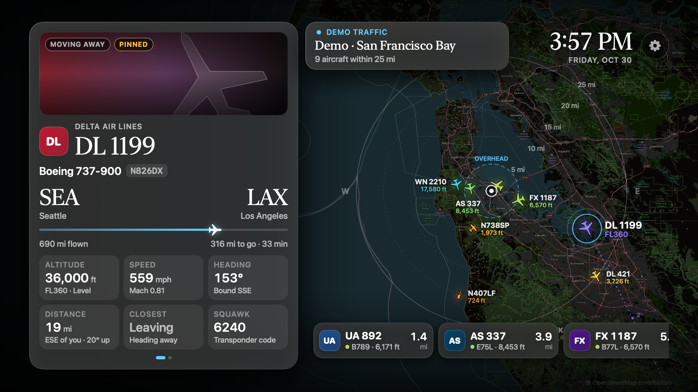

# Air Traffic

[](https://github.com/Jthe4th/air-traffic/actions/workflows/ci.yml)

**Version 1.1.2-beta** · tvOS · [Changelog](CHANGELOG.md) · [Roadmap](ROADMAP.md) · [Notes for contributors and AI agents](AGENTS.md)

A living-room display for Apple TV that shows the aircraft flying near your home: a dark live map, the plane
that's closest or overhead featured in detail (photo, airline, route, progress, altitude, speed, vertical rate,
closest approach, squawk, autopilot targets, wind aloft and more), and a strip of everything else in range.
No Home Assistant, no server, no paid Apple developer account needed.



*Rendered from the real SwiftUI views by `design-preview` with demo traffic. Blur and focus effects look better on a TV.*

## Run it on your Apple TV (free Apple ID)

1. `open AirTraffic.xcodeproj`
2. Target **AirTraffic ▸ Signing & Capabilities**: pick your Personal Team (or set `DEVELOPMENT_TEAM` in
   `Config/Local.xcconfig`). If the bundle ID is taken, change it (`com.feezerj.AirTraffic` in [project.yml](project.yml)).
3. Pair the Apple TV: on the TV, **Settings ▸ Remotes and Devices ▸ Remote App and Devices**; in Xcode,
   **Window ▸ Devices and Simulators ▸ +** and enter the code. Both must be on the same network.
4. Choose the Apple TV as the run destination and press Run.
5. First launch shows demo traffic. Open the gear (swipe up from the aircraft strip) and set your location by
   street address, ZIP/city, coordinates, or the Apple TV's own location.

Free-account builds expire after 7 days; run again from Xcode to refresh. If you change `project.yml`,
regenerate the project with `xcodegen generate` (`brew install xcodegen`).

**Remote:** swipe along the bottom strip to pick an aircraft (it stays featured for a minute), Play/Pause
pins or unpins, otherwise it follows the nearest and rotates through anything inside the overhead zone.
**Menu** steps back (it unpins an aircraft you chose) and otherwise does nothing, so a stray press can't close the
display; press the TV button on the remote to leave the app.

**Always-on display.** After 15 seconds without remote input the gear, zoom buttons and nearby strip fade away (any
remote movement brings them back, and the first press after a fade only wakes them). Between 10 PM and 6 AM the screen
dims, and the whole layout drifts a few pixels over time so a static image can't burn into an OLED panel. All three
are in Settings ▸ Display.

**Alerts.** An aircraft squawking 7500, 7600 or 7700, or reporting an emergency, gets a banner and a pulsing red ring
and takes over the aircraft card; aircraft flagged as notable get a banner too (Settings ▸ Data ▸ Alerts). A code must
hold for about 12 seconds first, because pilots dialling a squawk pass through 7700 briefly.

**Close flybys.** When an aircraft is about to pass within a couple of miles (below 20,000 ft by default), a card
appears about 45 seconds ahead saying which way to look: "Behind you · high up · moving left to right", with a small sky
dial. In Settings ▸ Close flybys say which way you face when you watch TV (from your seat toward the screen); then
"ahead" is past the TV and "behind" is behind your seat. You can name each side after a door or window ("Back door").
For directions that are right to within a house, enter your street address under Settings ▸ Location (it is looked up with
Apple Maps, and only the point and your town are kept): a ZIP or city search lands in the middle of town. Coordinates
can be pasted instead. **Show a sample card** puts a plane due north on screen so you can check the
settings against a compass app.

**Space Station.** A card appears 15 minutes (5, 10 or 30 if you prefer, in Settings ▸ Space Station) before the
International Space Station will be visible from your home, saying when it appears, which way to look, how high it gets and
how bright it will be, with a sky chart and a gentle chime as it begins (silent while the screen is dimmed at night). Whenever it flies over your home, day or night,
it also shows on the map and in the strip like any aircraft, labelled ISS. Its orbit is computed on the Apple TV from
elements downloaded from CelesTrak (nothing about your location is sent); passes are only announced when you could really
see it: lit by the Sun, sky dark, at least 20° up.

**Providers.** If adsb.fi (or adsb.lol) fails, the other one answers in the same update, then the preferred one is
retried after two minutes. Settings ▸ Connection shows which provider is answering, how recently, and any error.
The **+ / −** buttons on the map's right edge (swipe down from the gear) step the view through round radii
(5, 10, 25, 40, 60 mi, or the metric/nautical equivalents) and remember the choice. Zooming never reloads or
clears the map; the app already fetches a wider area than it shows.

## Aircraft photos and your contact

Photos come from Planespotters, whose API needs no account or key but asks every app to identify a contact
(an email or website) in its requests. Photos stay off until one is set, and it is sent **only to Planespotters**;
map and flight-data services see a generic app name.

- **Built-in default:** `AT_CONTACT` in [Config/App.xcconfig](Config/App.xcconfig). Put yours in
  `Config/Local.xcconfig` (git-ignored; copy `Local.xcconfig.example`) so it never lands in the source.
  If you distribute the app, use a support URL or project email here, not a personal address.
- **Per-viewer override:** Settings ▸ Aircraft photos ▸ contact. It wins over the default, and applies a moment
  after you stop typing. Only well-formed emails and web addresses are accepted.

`Local.xcconfig` also holds `DEVELOPMENT_TEAM` (your signing team) so regenerating the project keeps it, and
can set `AT_TILE_URL` / `AT_TILE_ATTRIBUTION` to use another map tile server (add `@2x` for 512 px tiles).

## How it's built

```
Sources/OverheadKit   engine, no UI: feeds, geometry, routes, tracking, reference data   (tvOS/iOS/macOS)
Sources/OverheadUI    SwiftUI: map, aircraft card, strip, settings                       (tvOS/iOS/macOS)
Sources/DesignPreview macOS tool that renders the TV layout to PNG
Apps/tvOS             the app target (@main, Info.plist, and the icon/Top Shelf asset catalog)
scripts/              make-icon-catalog.py builds the asset catalog from the rendered icon art
.github/workflows     CI: unit tests, and tvOS/iOS builds
Tests/OverheadKitTests  unit tests, including an anonymised adsb.fi capture
```

- **Positions:** adsb.fi (or adsb.lol) every 5 s; planes glide between updates by dead reckoning. Altitudes are above
  sea level: the pressure altitude aircraft report is corrected with the pressure setting nearby aircraft broadcast.
  Providers only ever see your location rounded to ~0.7 mi.
- **Space Station:** orbital elements from CelesTrak, propagated with SGP4 and checked against independent software.
  Only the station's catalogue number is requested, so your location is never sent for it. Passes are searched ten days
  ahead from your home; the Sun and Earth's shadow decide whether a pass is visible. See `Sources/OverheadKit/Space`.
- **Routes:** ADSB.lol standing data per callsign, shown only if the plane's position and heading actually fit
  the route. Callsigns get reused (the database says UAL2850 is SFO→ONT even when it's flying near Dulles),
  so a wrong route is rejected rather than displayed. See `RouteValidator`.
- **Maps:** OpenStreetMap raster tiles (your viewed area is visible to the tile server). Keep personal-scale.
- **Check each provider's current terms.** adsb.fi's open API is for personal, non-commercial use.
  (airplanes.live now requires contacting them for API access, so it isn't used.)

## Dev

```bash
swift test --scratch-path ~/Library/Caches/air-traffic-build            # unit tests
swift run --scratch-path ~/Library/Caches/air-traffic-build design-preview ./Preview busy quiet nophoto welcome zoomin zoomout crowded photoloading
swift run --scratch-path ~/Library/Caches/air-traffic-build design-preview ./Preview issupcoming issimminent issnow issover issquiet
```

Keep build output outside this folder; it lives in OneDrive. Scenes ending in `2` or `3` show the later
telemetry pages. Verified by: tests, compiling OverheadKit/OverheadUI against the tvOS and iOS SDKs, an unsigned
`xcodebuild` of the app for tvOS, and the rendered previews. Run by hand on an Apple TV 4K; older hardware is untested.

## What's next

See [ROADMAP.md](ROADMAP.md). Known gaps today: photos need a contact configured,
and remote focus around the newest controls and performance on older Apple TV hardware are unconfirmed.

## Credits

Inspired by [Overhead](https://github.com/alexlmiller/overhead) by alexlmiller (MIT), a quiet full-screen aircraft
display for Home Assistant and browsers. Air Traffic is an independent Swift implementation for Apple TV and shares
no code with it. It borrows a few ideas: a calm display built around the nearest aircraft with recent sightings,
and rejecting a reported route unless the aircraft's position and heading fit it. Space Station orbital data is from
[CelesTrak](https://celestrak.org).

## License

[MIT](LICENSE). Third-party data and marks (airline names, aircraft photos, map tiles, flight data) belong to their
owners and stay subject to each provider's terms.
